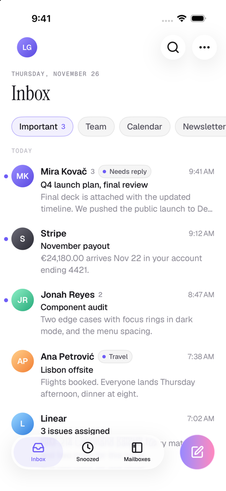

<div align="center">
  <picture>
    <source media="(prefers-color-scheme: dark)" srcset=".github/assets/icon-dark.png" />
    
  </picture>

  <h1>Nimbra for iOS</h1>

  <p><strong>Blazing fast mail. No bloat.</strong></p>

  <p>
    The iPhone companion to <a href="../nimbra-app">Nimbra for Mac</a>, written in SwiftUI with Liquid Glass.<br />
    Split inbox, snooze, signatures per account, and your mail kept on your iPhone.
  </p>

  <p>
    
    
    
    
    <a href="LICENSE"></a>
  </p>

  <p>
    <a href="#features">Features</a> ·
    <a href="#get-started">Get started</a> ·
    <a href="#privacy-and-security">Privacy</a> ·
    <a href="#development">Development</a> ·
    <a href="CONTRIBUTING.md">Contributing</a>
  </p>
</div>

<p align="center">
  <picture>
    <source media="(prefers-color-scheme: dark)" srcset=".github/assets/inbox-dark.png" />
    
  </picture>
</p>

## Features

Nimbra for iOS is early: the screens run on built-in sample mail while accounts and syncing are built.

- **Split inbox.** Important, Team, Calendar, Newsletters and Other as chips, each with its unread count, and threads under Today and Earlier.
- **Threads that read well.** The subject in a serif title, earlier messages folded into one line each, the latest in full with its attachments.
- **One tap for the usual.** Done, Snooze, Reply and Forward float at the bottom of every thread.
- **Snooze and reminders.** Later today, tomorrow, this weekend or next week, each with the time it comes back, or any date and time; **Only if nobody replies** makes it a reminder.
- **Writing.** From any account, recipients as chips, the signature under what you write, and a formatting bar.
- **Every account in one place.** Accounts, the split inbox and the mailboxes in Mailboxes, with their counts.
- **Inbox zero.** The aurora and a line for the day when a category is empty.
- **Liquid Glass and Dynamic Type.** The tab bar, the actions and the formatting bar are the system's glass; text follows the size you set; light and dark throughout.

## Get started

Requirements: a Mac with Xcode 26 or newer and [XcodeGen](https://github.com/yonaskolb/XcodeGen) (`brew install xcodegen`).

```sh
xcodegen
open Nimbra.xcodeproj
```

Run the `Nimbra` scheme on an iOS 26 simulator. Every Welcome button signs in to the sample mail; the launch argument `-SignedIn YES` starts on the inbox.

Run `xcodegen` again after adding, moving or removing files: `Nimbra.xcodeproj` is generated from `project.yml` and not committed.

## Privacy and security

- **Your mail stays on your iPhone.** Nimbra will talk straight to your mail provider, with no server of its own in between.
- **Secrets in the Keychain.** Sign-ins and passwords will live only in the Keychain, and mail in an encrypted store: never in `UserDefaults`, logs or the repo.

## Development

<details>
<summary><strong>Tests</strong></summary>

```sh
xcodebuild -project Nimbra.xcodeproj -scheme Nimbra \
  -destination 'platform=iOS Simulator,name=iPhone 17 Pro' test
```

The model's tests (Swift Testing) are in `NimbraTests`: the inbox order, Done, snooze times, unread counts, search, initials and replies.

</details>

### Layout

- `project.yml`: the XcodeGen spec (target, iOS 26, Swift 6, build settings)
- `Nimbra/App/`: the app entry, the root view (Welcome or the tabs) and the tab bar
- `Nimbra/Features/`: one folder per screen (Welcome, Inbox, Thread, Compose, Snooze, Snoozed, Mailboxes, Inbox zero, Search)
- `Nimbra/Model/`: the app state (`AppModel`), threads, messages, people, accounts and the sample mail
- `Nimbra/Design/`: text styles, icons, avatars, label pills, grouped cards and buttons
- `Nimbra/Resources/`: the asset catalog (colors, icons), fonts, the app icon (`AppIcon.icon`, the same Icon Composer file as the Mac app) and the string catalog
- `NimbraTests/`: unit tests

## Contributing

Bug fixes are welcome; for anything bigger, start a discussion first. [CONTRIBUTING.md](CONTRIBUTING.md) has how to
run it, what a good change looks like, and the commit style ([Conventional Commits](https://www.conventionalcommits.org/en/v1.0.0/)).
[CLAUDE.md](CLAUDE.md) holds the rules this codebase follows.
Found a security problem? Report it privately: see [SECURITY.md](SECURITY.md).

## License

[MIT](LICENSE)
