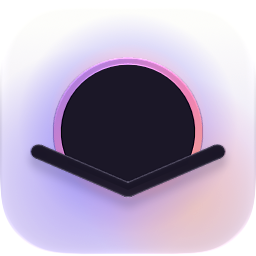
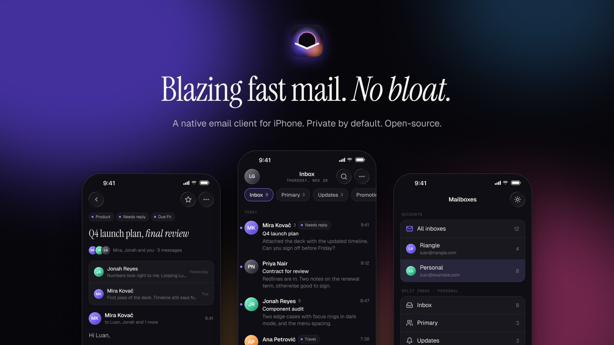

<div align="center">
  <picture>
    <source media="(prefers-color-scheme: dark)" srcset=".github/assets/icon-dark.png" />
    
  </picture>

  <h1>Nimbra for iOS</h1>

  <p><strong>Blazing fast mail. No bloat.</strong></p>

  <p>
    The iPhone companion to <a href="https://github.com/nimbra-mail/desktop">Nimbra for Mac</a>, written in SwiftUI with Liquid Glass.<br />
    Split inbox, snooze, signatures per account, and your mail kept on your iPhone.
  </p>

  <p>
    
    
    
    
    <a href="LICENSE"></a>
  </p>

  <p>
    <a href="#features">Features</a> ·
    <a href="#get-it">Get it</a> ·
    <a href="#privacy">Privacy</a> ·
    <a href="docs/development.md">Development</a> ·
    <a href="CONTRIBUTING.md">Contributing</a>
  </p>
</div>

<p align="center">
  
</p>

## Features

Nimbra for iOS is early, and every feature below runs on the same mail engine as the Mac app.

- **Your accounts.** Gmail and Google Workspace, Outlook.com and Microsoft 365 through their own sign-in pages, and any other address with its IMAP and SMTP servers, found for you or typed in. Several at once.
- **Split inbox.** A Gmail account's Primary, Updates, Promotions and Social as chips, each with its unread count, and threads under Today and Earlier. Other accounts have one inbox.
- **Threads that read well.** The subject in a serif title, earlier messages folded into one line each, the latest in full with its attachments.
- **One tap for the usual.** Done, Snooze, Reply and Forward float at the bottom of every thread.
- **Snooze and reminders.** Later today, tomorrow, this weekend or next week, each with the time it comes back, or any date and time; **Only if nobody replies** makes it a reminder.
- **Writing.** From any account, recipients as chips, the signature under what you write, and a formatting bar.
- **Search, labels and blocking.** Search any account, file threads under labels, and send a sender's mail straight to Blocked.
- **Every account in one place.** Accounts, the split inbox and the mailboxes in Mailboxes, with their counts.
- **Inbox zero.** The aurora and a line for the day when a category is empty.
- **Liquid Glass and Dynamic Type.** The tab bar, the actions and the formatting bar are the system's glass; text follows the size you set; light and dark throughout.

## Get it

Nimbra for iOS isn't on the App Store or TestFlight yet. To try it, build it with Xcode 26 and [XcodeGen](https://github.com/yonaskolb/XcodeGen) on a Mac:

```sh
brew install xcodegen
xcodegen
open Nimbra.xcodeproj
```

Run the `Nimbra` scheme on an iOS 26 simulator. Any address with an IMAP password works right away; Google and Microsoft sign-in need client ids of your own first. [Developing Nimbra for iOS](docs/development.md) has that, the sample mail for screenshots, and how to build against your own copy of the mail engine. No Rust is needed: the engine comes prebuilt from [nimbra-core](https://github.com/nimbra-mail/core).

## Privacy

- **Your mail stays on your iPhone.** Nimbra talks straight to your mail provider, with no server of its own in between.
- **Secrets in the Keychain.** Sign-ins and passwords live only in the Keychain (after first unlock, this device only, never synced), and mail in the engine's encrypted store, excluded from backups: never in `UserDefaults`, logs or the repo.
- **Your own resolver.** Finding an address's servers asks the system's DNS, never a DNS-over-HTTPS service.

## Documentation

- [Developing Nimbra for iOS](docs/development.md): building, sign-in, the engine, tests and where things live
- [Architecture](docs/architecture.md): the layers, and where a feature plugs in
- [CONTRIBUTING.md](CONTRIBUTING.md): what a good change looks like, and the commit style

## Contributing

Bug fixes are welcome; for anything bigger, start a discussion first. [CONTRIBUTING.md](CONTRIBUTING.md) has how to
run it, what a good change looks like, and the commit style ([Conventional Commits](https://www.conventionalcommits.org/en/v1.0.0/)).
Found a security problem? Report it privately: see [SECURITY.md](SECURITY.md).

## License

[MIT](LICENSE)
